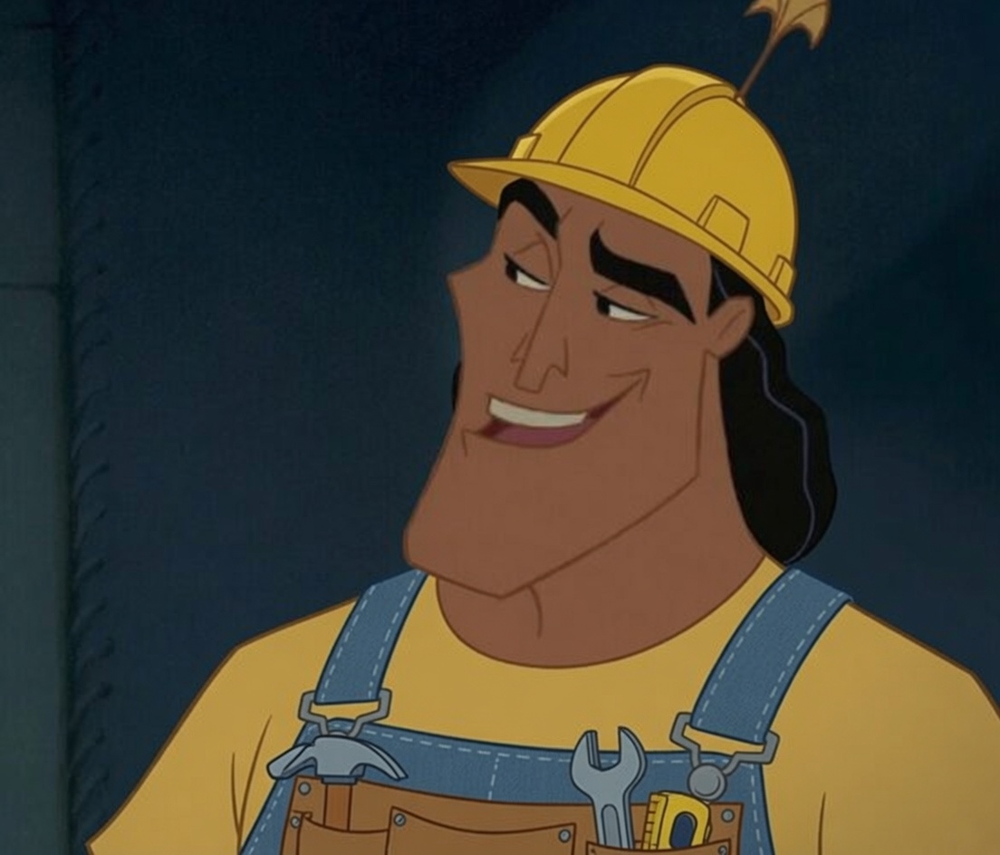

<!-- Improved compatibility of back to top link: See: https://github.com/othneildrew/Best-README-Template/pull/73 -->
<a id="readme-top"></a>
<!--
*** Thanks for checking out the Best-README-Template. If you have a suggestion
*** that would make this better, please fork the repo and create a pull request
*** or simply open an issue with the tag "enhancement".
*** Don't forget to give the project a star!
*** Thanks again! Now go create something AMAZING! :D
-->


<!-- PROJECT SHIELDS -->
<!--
*** I'm using markdown "reference style" links for readability.
*** Reference links are enclosed in brackets [ ] instead of parentheses ( ).
*** See the bottom of this document for the declaration of the reference variables
*** for contributors-url, forks-url, etc. This is an optional, concise syntax you may use.
*** https://www.markdownguide.org/basic-syntax/#reference-style-links
-->
[![Contributors][contributors-shield]][contributors-url]
[![Forks][forks-shield]][forks-url]
[![Stargazers][stars-shield]][stars-url]
[![Issues][issues-shield]][issues-url]
[![License][license-shield]][license-url]
[![LinkedIn][linkedin-shield]][linkedin-url]


<!-- PROJECT LOGO -->
<br />
<div align="center">
  <a href="https://github.com/kronkorp/kronkworld">
    
  </a>

<h3 align="center">KronkWorld</h3>

  <p align="center">
    A light ECS in C++
    <br />
    <a href="https://github.com/kronkorp/kronkworld"><strong>Explore the docs</strong></a>
    <br />
    <br />
    <a href="https://github.com/kronkorp/kronkworld">View Demo</a>
    &middot;
    <a href="https://github.com/kronkorp/kronkworld/issues/new?labels=bug&template=bug-report---.md">Report Bug</a>
    &middot;
    <a href="https://github.com/kronkorp/kronkworld/issues/new?labels=enhancement&template=feature-request---.md">Request Feature</a>
  </p>
</div>


<!-- TABLE OF CONTENTS -->
<details>
  <summary>Table of Contents</summary>
  <ol>
    <li>
      <a href="#about-the-project">About The Project</a>
      <ul>
        <li><a href="#built-with">Built With</a></li>
      </ul>
    </li>
    <li>
      <a href="#getting-started">Getting Started</a>
      <ul>
        <li><a href="#installation">Installation</a></li>
      </ul>
    </li>
    <li>
      <a href="#usage">Usage</a>
      <ul>
        <li><a href="#components-and-entities">Components and entities</a></li>
        <li><a href="#views">Views</a></li>
        <li><a href="#resources">Resources</a></li>
        <li><a href="#systems">Systems</a></li>
        <li><a href="#full-example">Full example</a></li>
      </ul>
    </li>
    <li><a href="#benchmarks">Benchmarks</a></li>
    <li><a href="#contributing">Contributing</a></li>
    <li><a href="#license">License</a></li>
    <li><a href="#contact">Contact</a></li>
  </ol>
</details>


<!-- ABOUT THE PROJECT -->
## About The Project

<!-- [![Product Name Screen Shot][product-screenshot]](https://example.com) -->

KronkWorld is a small ECS (Entity Component System) for C++20.

* **Entities** are plain ids (`kw::Entity`, a `uint64_t`).
* **Components** are any C++ type, stored in one packed array per type (sparse set).
* **Systems** are classes with a `handle(World&)` method, run by a scheduler by stage.
* **Resources** are global singletons owned by the `World` (window, delta time, score...).

The API fits in `kw::World`. A working game lives in [`example/snake`](example/snake).

<p align="right">(<a href="#readme-top">back to top</a>)</p>


### Built With

* C++20
* [kronkflow](https://github.com/kronkorp/kronkflow) (the scheduler, fetched by CMake)

<p align="right">(<a href="#readme-top">back to top</a>)</p>


<!-- GETTING STARTED -->
## Getting Started

To get a local copy up and running follow these simple example steps.

### Prerequisites

* CMake >= 3.15
* A C++20 compiler
```sh
apt install cmake g++
```

### Installation

With CMake's `FetchContent` (or `add_subdirectory`, like [`example/snake`](example/snake) does):

```cmake
include(FetchContent)
FetchContent_Declare(
    kronkworld
    GIT_REPOSITORY https://github.com/kronkorp/kronkworld
    GIT_TAG        main
)
FetchContent_MakeAvailable(kronkworld)

target_link_libraries(my_game PRIVATE kronkworld::static) # or kronkworld::shared
```

Then `#include <kronkworld/Kronkworld.hpp>`.

To build and run the unit tests:

```sh
cmake -S . -B build -DBUILD_TESTS=ON
cmake --build build -j
./build/kronkworld_tests
```

<p align="right">(<a href="#readme-top">back to top</a>)</p>


<!-- USAGE EXAMPLES -->
## Usage

Everything goes through a `kw::World`:

```cpp
#include <kronkworld/Kronkworld.hpp>

kw::World world;
```

### Components and entities

A component is any type, no base class needed. Tags (empty structs) work too.

```cpp
struct Position { float x, y; };
struct Velocity { float dx, dy; };
struct Player {};

// Create an entity with its components in one go
kw::Entity player = world.spawn(Player{}, Position{0.f, 0.f}, Velocity{60.f, 0.f});

// ...or step by step
kw::Entity rock = world.create();
world.add<Position>(rock, 10.f, 10.f);      // constructor args are forwarded

world.get<Position>(rock).x += 1.f;         // read / write
bool moves = world.has<Velocity>(rock);     // false
world.remove<Position>(rock);               // remove one component
world.remove(player);                       // destroy the entity (ids are recycled)
```

### Views

A view iterates over the entities that own **all** the requested components.

```cpp
// Callback style
world.view<Position, Velocity>().foreach(
    [](kw::Entity e, Position& pos, Velocity& vel) {
        pos.x += vel.dx;
        pos.y += vel.dy;
    });

// Range-for style
for (kw::Entity e : world.view<Player, Position>())
    world.get<Position>(e).x = 0.f;

auto players = world.view<Player>();
players.size();    // how many
players.empty();
players.first();   // throws kw::BadEntity if there is none
```

A view walks the **smallest** of the component arrays and checks the others, so a rare component keeps the view cheap (see the sparse benchmark).

### Resources

A resource is a global of the world: one instance per type.

```cpp
struct Dt { float seconds; };

world.addResource<Dt>(1.f / 60.f);              // constructor args are forwarded
float dt = world.getResource<Dt>().seconds;
world.getResource<Dt>().seconds = 0.016f;
world.removeResource<Dt>();
```

### Systems

A system derives from `kw::ISystem`. Return `true` to run again on the next tick, `false` to never run again (handy for startup systems).

```cpp
class MovementSystem : public kw::ISystem {
public:
    bool handle(kw::World& world) override
    {
        const float dt = world.getResource<Dt>().seconds;

        world.view<Position, Velocity>().foreach(
            [dt](kw::Entity, Position& pos, Velocity& vel) {
                pos.x += vel.dx * dt;
                pos.y += vel.dy * dt;
            });
        return true;
    }
};

enum Stage : size_t { Startup, Update, Render };

world.addSystem(Update, std::make_unique<MovementSystem>());
```

* `addSystem(stage, system, delay = 1, interval = 1)`: lower stages run first; systems of the same stage run in the order they were added. `delay` is the first tick it runs on, `interval` the number of ticks between two runs.
* The world has two schedules, `Schedule::Fixed` (the default) and `Schedule::Frame`, each with its own tick counter. `addSystem(Schedule::Frame, stage, ...)` picks one.
* `world.runOnce()` runs one tick of both (Fixed, then Frame), `world.runOnce(Schedule::Fixed)` only one. `world.run()` loops on `runOnce()` until a system calls `world.stop()`.
* `world.scheduleSystem(...)` does the same as `addSystem` but returns a `SystemHandle` for `world.removeSystem(handle)`.

### Full example

```cpp
#include <kronkworld/Kronkworld.hpp>
#include <cstdio>
#include <memory>

struct Position { float x, y; };
struct Velocity { float dx, dy; };
struct Player {};
struct Dt { float seconds; };

enum Stage : size_t { Update, Render };

class MovementSystem : public kw::ISystem {
public:
    bool handle(kw::World& world) override
    {
        const float dt = world.getResource<Dt>().seconds;

        world.view<Position, Velocity>().foreach(
            [dt](kw::Entity, Position& pos, Velocity& vel) {
                pos.x += vel.dx * dt;
                pos.y += vel.dy * dt;
            });
        return true;
    }
};

class PrintSystem : public kw::ISystem {
public:
    bool handle(kw::World& world) override
    {
        for (auto e : world.view<Player, Position>())
            std::printf("player at (%.1f, %.1f)\n", world.get<Position>(e).x, world.get<Position>(e).y);
        return true;
    }
};

int main()
{
    kw::World world;

    world.addResource<Dt>(1.f / 60.f);
    world.spawn(Player{}, Position{0.f, 0.f}, Velocity{60.f, 0.f});
    world.spawn(Position{10.f, 10.f}); // no Velocity: MovementSystem ignores it

    world.addSystem(Update, std::make_unique<MovementSystem>())
         .addSystem(Render, std::make_unique<PrintSystem>());

    for (int i = 0; i < 3; ++i)
        world.runOnce();
}
```

```
player at (1.0, 0.0)
player at (2.0, 0.0)
player at (3.0, 0.0)
```

For a complete game (window, input, startup systems, resources), see [`example/snake`](example/snake).

<p align="right">(<a href="#readme-top">back to top</a>)</p>


## Benchmarks

**Setup**: AMD Ryzen 7 7745HX (16 threads), g++ 15.2, `-O3`, Linux, single thread. Each figure is the **median of 7 runs**; the world is rebuilt before every run and the setup is not timed.

**Components**: `Position {float x, y}` (8 B), `Velocity {float dx, dy}` (8 B), `Health {int hp}` (4 B).

**Entities**: dense entities own `Position` + `Velocity`. The "mixed shapes" world is split in thirds: `Position`, `Position + Velocity`, `Health + Velocity`.

| Operation | 1 000 entities | 10 000 | 100 000 | 1 000 000 |
|---|---:|---:|---:|---:|
| `spawn(Position, Velocity)` (total) | 0.02 ms | 0.44 ms | 4.5 ms | 40 ms |
| `spawn(Position, Velocity)` (per entity) | 17 ns | 44 ns | 45 ns | 40 ns |
| `view<Position, Velocity>().foreach`, dense | 0.009 ms | 0.083 ms | 0.80 ms | 9.2 ms |
| range-for + `world.get<C>(e)`, dense | 0.009 ms | 0.084 ms | 0.83 ms | 8.5 ms |
| `view<Position, Velocity>`, `Velocity` on 1 % of the entities | 0.001 ms | 0.002 ms | 0.012 ms | 0.25 ms |
| `world.remove(e)` on 50 % of the entities, mixed shapes | 0.06 ms | 0.56 ms | 5.6 ms | 58 ms |

What it says:

* **Creation is flat**: about 40-45 ns per entity with two components, from 10k to 1M entities (no cap, storage grows on demand).
* **Iteration is linear**: about 8-9 ns per entity, which includes the signature check and one lookup per component.
* **Sparse views are cheap**: the view walks the smaller array, so 10 000 `Velocity` among 1M `Position` take 0.25 ms instead of 9 ms.
* **Removal** costs about 110 ns per removed entity at 1M (all component boxes of the entity are swap-and-popped).

Scheduler overhead (empty systems, `runOnce(Schedule::Fixed)`):

| Scenario | Cost |
|---|---:|
| 1 system, 1 000 000 ticks | 24 ns / tick |
| 100 systems over 8 stages, 100 000 ticks | 4.0 µs / tick (≈ 40 ns / system) |
| `MovementSystem` above, 100 000 entities, 1 000 ticks | 0.81 ms / tick |

At 100 000 moving entities one tick costs 0.8 ms, i.e. about 5 % of a 60 FPS frame budget (16.7 ms).

These numbers come from a local run, they are not a guarantee: run it on your own machine before comparing with another ECS. The benchmark is not versioned in the repo; the setup is described above so it can be redone.

<p align="right">(<a href="#readme-top">back to top</a>)</p>


<!-- CONTRIBUTING -->
## Contributing

Contributions are what make the open source community such an amazing place to learn, inspire, and create. Any contributions you make are **greatly appreciated**.

If you have a suggestion that would make this better, please fork the repo and create a pull request. You can also simply open an issue with the tag "enhancement".
Don't forget to give the project a star! Thanks again!

1. Fork the Project
2. Create your Feature Branch (`git checkout -b feature/AmazingFeature`)
3. Commit your Changes (`git commit -m 'Add some AmazingFeature'`)
4. Push to the Branch (`git push origin feature/AmazingFeature`)
5. Open a Pull Request

<p align="right">(<a href="#readme-top">back to top</a>)</p>

### Top contributors:

<a href="https://github.com/kronkorp/kronkworld/graphs/contributors">
  
</a>


<!-- LICENSE -->
## License

Distributed under the MIT license. See `LICENSE` for more information.

<p align="right">(<a href="#readme-top">back to top</a>)</p>


<!-- CONTACT -->
## Contact

Gauthier Malfilatre - [@GauthierMalfilatre](https://www.linkedin.com/in/gauthier-malfilatre-648001339/) - gauthier.malfilatre@epitech.eu

Project Link: [https://github.com/kronkorp/kronkworld](https://github.com/kronkorp/kronkworld)

<p align="right">(<a href="#readme-top">back to top</a>)</p>


<!-- MARKDOWN LINKS & IMAGES -->
<!-- https://www.markdownguide.org/basic-syntax/#reference-style-links -->
[contributors-shield]: https://img.shields.io/github/contributors/kronkorp/kronkworld.svg?style=for-the-badge
[contributors-url]: https://github.com/kronkorp/kronkworld/graphs/contributors
[forks-shield]: https://img.shields.io/github/forks/kronkorp/kronkworld.svg?style=for-the-badge
[forks-url]: https://github.com/kronkorp/kronkworld/network/members
[stars-shield]: https://img.shields.io/github/stars/kronkorp/kronkworld.svg?style=for-the-badge
[stars-url]: https://github.com/kronkorp/kronkworld/stargazers
[issues-shield]: https://img.shields.io/github/issues/kronkorp/kronkworld.svg?style=for-the-badge
[issues-url]: https://github.com/kronkorp/kronkworld/issues
[license-shield]: https://img.shields.io/github/license/kronkorp/kronkworld.svg?style=for-the-badge
[license-url]: https://github.com/kronkorp/kronkworld/blob/main/LICENSE
[linkedin-shield]: https://img.shields.io/badge/-LinkedIn-black.svg?style=for-the-badge&logo=linkedin&colorB=555
[linkedin-url]: https://linkedin.com/in/linkedin_username
[product-screenshot]: images/screenshot.png
<!-- Shields.io badges. You can a comprehensive list with many more badges at: https://github.com/inttter/md-badges -->
[Next.js]: https://img.shields.io/badge/next.js-000000?style=for-the-badge&logo=nextdotjs&logoColor=white
[Next-url]: https://nextjs.org/
[React.js]: https://img.shields.io/badge/React-20232A?style=for-the-badge&logo=react&logoColor=61DAFB
[React-url]: https://reactjs.org/
[Vue.js]: https://img.shields.io/badge/Vue.js-35495E?style=for-the-badge&logo=vuedotjs&logoColor=4FC08D
[Vue-url]: https://vuejs.org/
[Angular.io]: https://img.shields.io/badge/Angular-DD0031?style=for-the-badge&logo=angular&logoColor=white
[Angular-url]: https://angular.io/
[Svelte.dev]: https://img.shields.io/badge/Svelte-4A4A55?style=for-the-badge&logo=svelte&logoColor=FF3E00
[Svelte-url]: https://svelte.dev/
[Laravel.com]: https://img.shields.io/badge/Laravel-FF2D20?style=for-the-badge&logo=laravel&logoColor=white
[Laravel-url]: https://laravel.com
[Bootstrap.com]: https://img.shields.io/badge/Bootstrap-563D7C?style=for-the-badge&logo=bootstrap&logoColor=white
[Bootstrap-url]: https://getbootstrap.com
[JQuery.com]: https://img.shields.io/badge/jQuery-0769AD?style=for-the-badge&logo=jquery&logoColor=white
[JQuery-url]: https://jquery.com 
